# Centinel

**A quality check for apps you built with AI.** Centinel reads your code, compares it with what your app is supposed to do, then opens your website in a real browser to check that it works. You get a plain-language report that says what is wrong, why it matters and how to fix it.

<p align="center">
  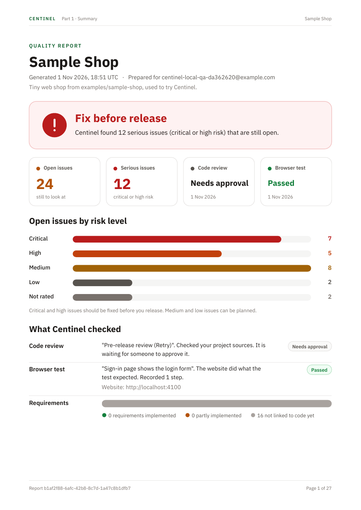
</p>

Centinel has two parts:

| | What it does | Good for |
| --- | --- | --- |
| **Review** | Reads your source code and requirements without running the app. Finds security, business-rule and technical problems and points to the exact file and line. | Catching bugs an AI assistant introduced before anyone uses the app. |
| **Dynamic Testing** | Opens your website in a real Chromium browser, follows a goal you write in plain English and checks the result independently. Saves screenshots and every step. | Proving the app actually works, not just that the code looks right. |

Both feed one **quality report** (PDF, Markdown or JSON). The first part is written for anyone; the second part keeps the full technical detail for developers.

---

## Contents

- [Download and install](#download-and-install)
- [Try it in 10 minutes with the Sample Shop](#try-it-in-10-minutes-with-the-sample-shop)
- [The quality report](#the-quality-report)
- [Requirements and limits](#requirements-and-limits)
- [Run from source](#run-from-source)
- [Project structure](#project-structure)

---

## Download and install

> Centinel 0.2.1 is an early release for **macOS** (macOS 11 or newer, Apple silicon or Intel).

1. Download the disk image for your Mac from the [Releases page](https://github.com/kongjiyu/centinel/releases): `Centinel_0.2.1_aarch64.dmg` for Apple silicon (M1 or newer), `Centinel_0.2.1_x64.dmg` for Intel. To check which you have, open the Apple menu → **About This Mac**: *Chip: Apple M…* means Apple silicon.
2. Open the DMG and drag **Centinel** into **Applications**.
3. Open Centinel from Applications. The app is signed with a Developer ID and notarized by Apple, so macOS opens it without a security warning.

On first launch Centinel starts its local service in the background and downloads the Chromium browser it uses for Dynamic Testing (a few hundred MB, once). Your local files stay in `~/Library/Application Support/com.centinel.app`. [PRIVACY.md](PRIVACY.md) explains what is stored where, what is sent to the AI provider and how to delete it.

**Updates install themselves.** When a new version is published, Centinel shows **Update available** in the corner of the window. Click **Restart** and it downloads the signed update, replaces itself and reopens. You can also check under **Settings → App Version**. Updates are signed, and Centinel refuses any download whose signature doesn't match.

### What you also need

- **A Centinel account.** Sign up inside the app with email, Google or GitHub.
- **A ChatGPT account.** Centinel uses your ChatGPT plan for its AI. Click **Connect ChatGPT** (in the first-run guide, or under **Settings → Model Provider**) and sign in through your browser. You don't need an API key or any other install, because Centinel includes the official [Codex CLI](https://github.com/openai/codex) (Apache-2.0) for this connection. Usage counts toward your plan's limits. You can also use any OpenAI-compatible API key instead.
- **An internet connection** for sign-in, saving projects and the AI model.

---

## Try it in 10 minutes with the Sample Shop

Centinel includes the Sample Shop ([`examples/sample-shop`](examples/sample-shop)), a tiny web shop with sign-in, products and checkout, plus a [requirements document](examples/sample-shop/docs/requirements.md). It has **three bugs planted on purpose**, so you can see what Centinel finds.

<p align="center">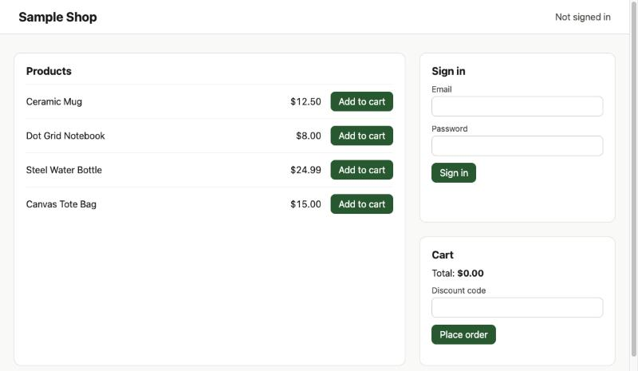</p>

### The first-run guide

The first time you sign in, Home shows **Get started with the Sample Shop**. It walks you through five steps, one button each:

1. **Connect ChatGPT.** Sign in through your browser. Centinel picks your plan's default model for Review and Dynamic Testing; you can change it later in Settings.
2. **Create the Sample Shop project.** Centinel copies the shop to `~/Library/Application Support/com.centinel.app/samples/sample-shop`, runs it at <http://localhost:4100> and imports its code and requirements.
3. **Confirm its requirements.** Centinel extracts candidates from `docs/requirements.md`. Untick any you disagree with, then confirm the rest.
4. **Start a Review and a browser test.** The Review goal is filled in for you, and so is a browser test, *Sign-in page shows the login form*. It opens <http://localhost:4100> and checks that "Sign in" is visible.
5. **Open the report.** When the Review finishes (about eleven minutes in our run), create the report and download the PDF.

<p align="center">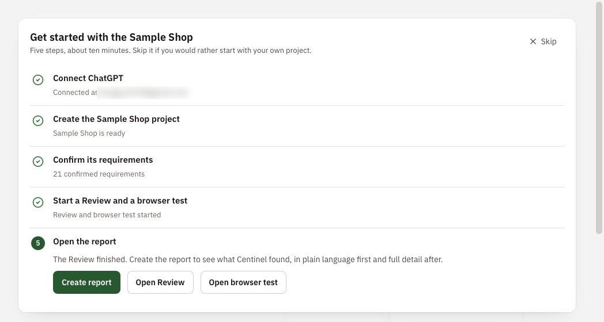</p>

Click **Skip** if you'd rather start with your own project. Centinel remembers that choice for your account. The steps below do the same thing by hand and explain each screen.

### 1. Start the Sample Shop

The first-run guide starts the shop for you. To run it yourself from a clone of this repository, you need [Node.js](https://nodejs.org/) 18 or newer and nothing else:

```bash
git clone https://github.com/kongjiyu/centinel.git
cd centinel/examples/sample-shop
node server.js
```

Open <http://localhost:4100> to check it is running. Leave this terminal open.

### 2. Sign in to Centinel

Open Centinel and create an account, or sign in with Google or GitHub.

<p align="center">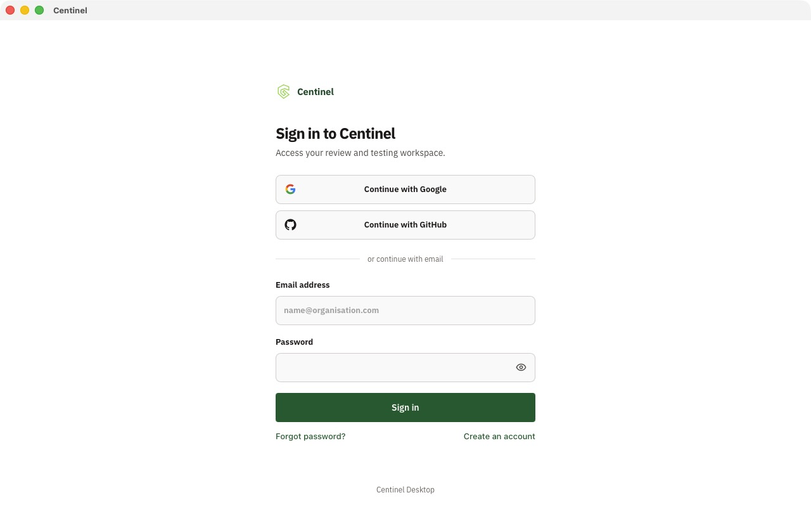</p>

Then open **Settings → Model Provider**, click **Connect ChatGPT**, sign in and choose a model under **Review model** and **Dynamic testing model** (for example `GPT-5.6-Sol`).

### 3. Create a project

1. Go to **Projects → New project**.
2. Name it `Sample Shop`.
3. Under **Local repository**, click **Choose repository** and select the `examples/sample-shop` folder.
4. Click **Create project**. Centinel imports the files, including the requirements document.

<p align="center">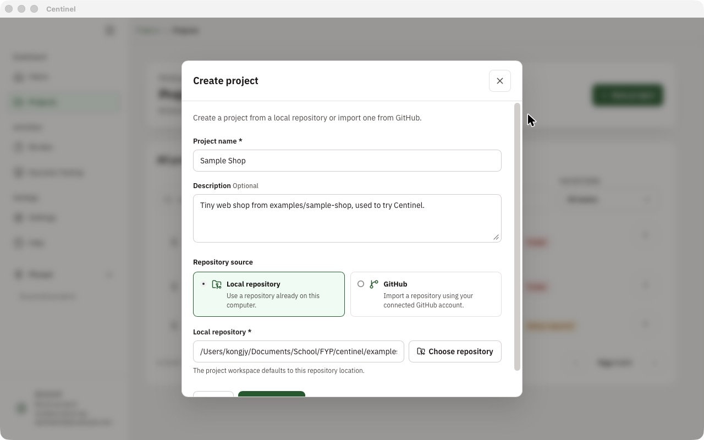</p>

### 4. Confirm the requirements

Centinel checks code against requirements you have confirmed, so it never treats a guess as a rule.

1. Open the project, go to **Source**, and click **Manage requirements**.
2. Choose `requirements.md` and click **Extract candidates**.
3. Read each candidate and click **Confirm** for the ones that are right. The Sample Shop has 16.

<p align="center">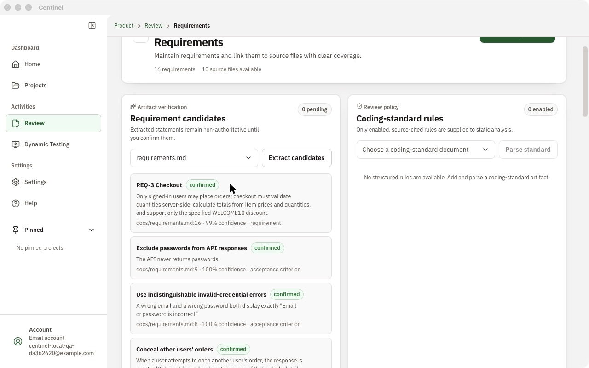</p>

### 5. Run a code Review

1. Click **Review** in the sidebar.
2. Name it `Pre-release review`, pick the **Sample Shop** project, and under **What should this Review verify?** write:
   > Check that sign-in, checkout and order viewing follow docs/requirements.md, especially privacy and server-side validation.
3. Click **Start review**. A project this size took about eleven minutes in our run.

<p align="center">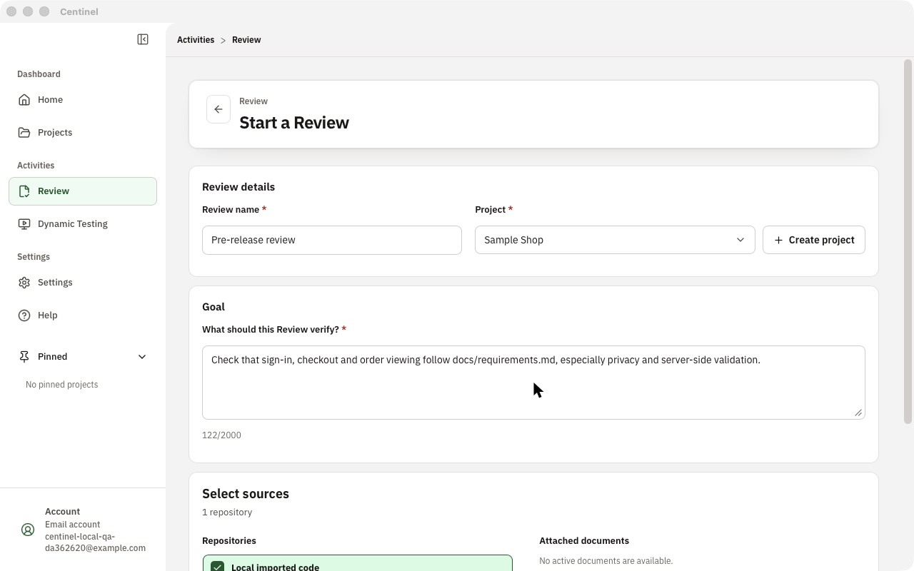</p>

When the Review finishes it waits for your decision:

<p align="center">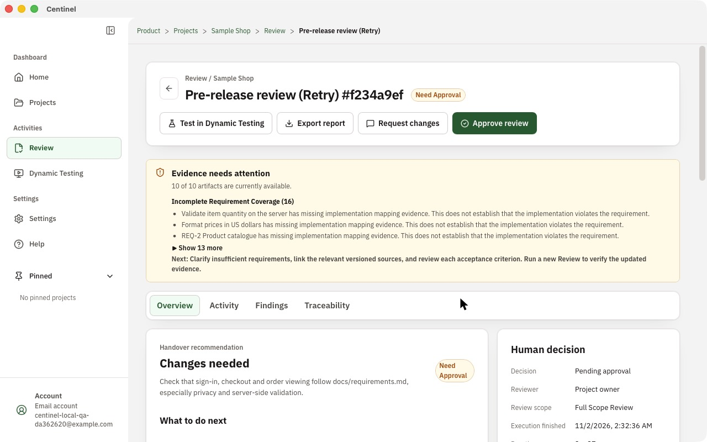</p>

The yellow box lists evidence gaps. Here it says the 16 requirements are not yet linked to the code that implements them. That limits what Centinel can prove about coverage, but it does not mean the code is wrong.

Open **Findings** to see the problems. In our 0.2 run Centinel found all three planted bugs, plus a possible hardcoded credential and an order-number collision:

<p align="center">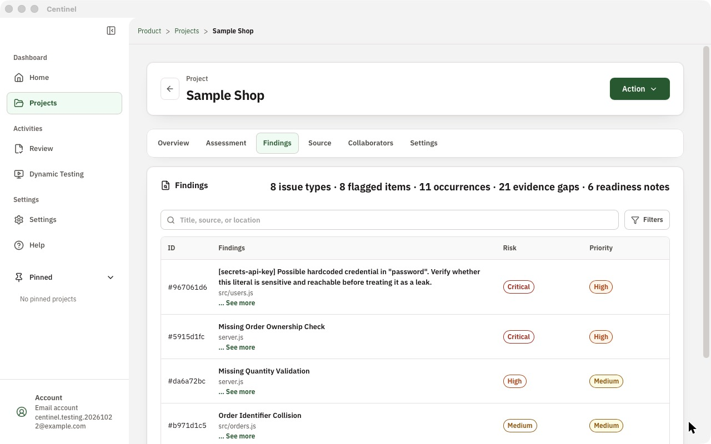</p>

| Requirement | What Centinel found |
| --- | --- |
| REQ-1 Sign-in | *Account Enumeration*: the error message reveals which emails have accounts. |
| REQ-3 Checkout | *Missing Quantity Validation*: the server accepts any quantity, so totals can go negative. |
| REQ-4 Order privacy | *Missing Order Ownership Check*: any signed-in user can open someone else's order and address. |

Click a finding to see what to do, where it is, why it matters and the evidence. **Copy fix prompt** copies a ready-made prompt for Cursor, Claude Code or Codex. After you fix it, **Re-check** runs a Review of your updated code against the earlier one; if the issue is no longer found, the finding says so and offers **I fixed it — mark as resolved**:

<p align="center">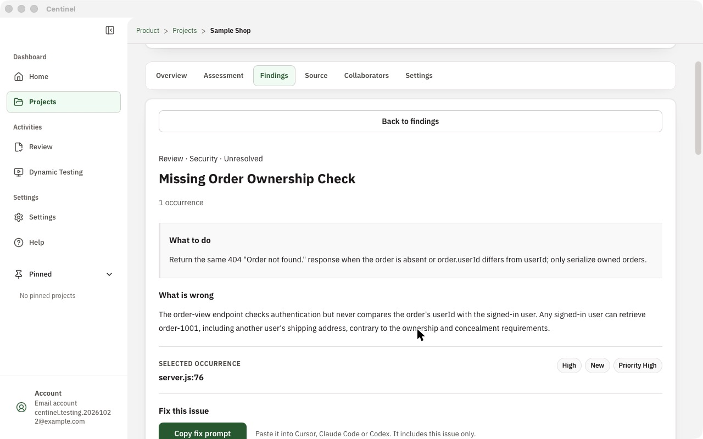</p>

AI results vary between runs, so your titles and counts may differ slightly. The full answer key is in [`examples/sample-shop-answers.md`](examples/sample-shop-answers.md). Approve the Review or request changes once you have looked at the evidence.

### 6. Run a Dynamic Test in a real browser

1. Click **Dynamic Testing** and pick the **Sample Shop** project.
2. Fill in **New test**:
   - **Test name:** `Sign-in page shows the login form`
   - **Website address:** `http://localhost:4100`
   - **Test goal:** `Open the shop and confirm that the sign-in form and the product list are shown. Do not sign in.`
   - **Criteria source:** Write my own criteria
   - **Acceptance check:** Visible text → `Sign in` (required)
3. Click **Save test**, then **Run saved test**.

Centinel opens Chromium, follows the goal, then checks the result independently of the AI:

<p align="center">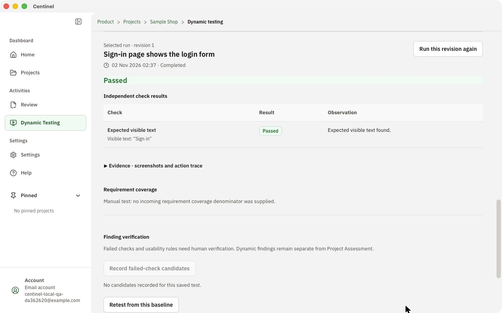</p>

Open **Evidence · screenshots and action trace** to see every step the browser took.

> Tip: to test signed-in flows, add the demo account (`demo@example.com` / `demo-password-123`) under **Manage environments and local values**. Centinel keeps these values on your Mac and never sends them to the AI as text.

### 7. Export the report

Open the project, click **Action → Export report**, then **Download PDF**.

---

## The quality report

Every report has two parts.

**Part 1 · Summary** is for anyone, including non-technical teammates. It starts with a verdict (*Fix before release*, *Needs attention*, *Looking good* or *Not checked yet*), shows the key numbers and a chart of open issues by risk, lists up to three next steps, and explains the top issues in plain language.

<p align="center">
  
  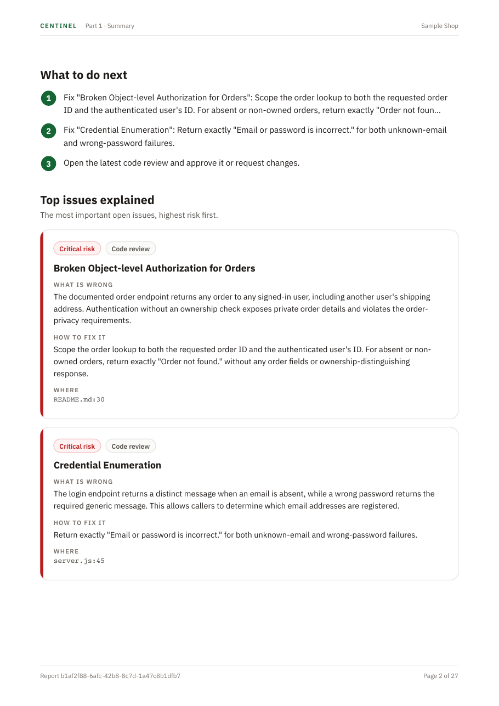
</p>

**Part 2 · Technical details** keeps the complete record for developers and auditors: IDs, versions, timestamps, every finding with evidence, the files that were reviewed, requirement coverage, browser-test steps and AI usage.

*These pages come from the real Sample Shop run above, exported from the app. Download the full [report (PDF)](docs/screenshots/example-report.pdf).*

Risk levels mean:

| Level | Meaning |
| --- | --- |
| Critical | Could cause a security breach, data loss or a broken core feature. Fix before release. |
| High | Likely to break an important feature or expose data. Fix before release. |
| Medium | Causes problems in some situations. Plan a fix soon. |
| Low | Minor issue or clean-up. Fix when convenient. |

---

## Requirements and limits

- **Platform:** installers are for macOS (Apple silicon and Intel). A Windows installer can be built with the *Windows build* GitHub Actions workflow; it is unsigned and not yet tested on a real Windows PC, so Windows SmartScreen warns before it opens.
- **AI model:** Review and Dynamic Testing need a configured model. Centinel stops instead of guessing when the provider is out of quota.
- **Honest results:** if Centinel cannot verify part of the code, it says so rather than reporting a clean result. When some sections cannot be verified, the Review ends as *Completed with gaps* and lists those sections; it ends as *Failed* only when nothing could be verified. Very large repositories can take a long time, so start with a focused project.
- **What Review does not prove:** it reads code; it does not run every path. Pair it with Dynamic Testing for behaviour that matters.
- **Integrations:** GitHub repository import, Google Drive and Slack need OAuth apps configured by whoever builds Centinel; they are optional.

---

## Run from source

For contributors. You need [Node.js](https://nodejs.org/) 20+, [pnpm](https://pnpm.io/) 10, [Rust](https://www.rust-lang.org/tools/install) and the [Tauri prerequisites](https://tauri.app/start/prerequisites/).

```bash
git clone https://github.com/kongjiyu/centinel.git
cd centinel
pnpm install
cp .env.example .env   # add your Supabase URL and publishable key
pnpm dev               # local service + desktop app with hot reload
```

Set up Supabase (Auth redirects, migrations and Storage) with [`docs/SUPABASE_SETUP.md`](docs/SUPABASE_SETUP.md). Never put a Supabase service-role key in `.env` for the desktop app.

| Command | What it does |
| --- | --- |
| `pnpm dev` | Starts the local service on port 37701 and the desktop app. |
| `pnpm --filter centinel test` | Frontend tests. |
| `pnpm --filter @centinel/sidecar test` | Local service tests. |
| `pnpm --filter centinel build` | Type-checks and builds the frontend. |
| `pnpm build` | Bundles the local service and Node.js runtime, then builds the desktop app. |
| `pnpm release:mac` | Builds a signed, notarized macOS disk image in `dist/release/`. |

`pnpm build` runs [`scripts/bundle-sidecar.mjs`](scripts/bundle-sidecar.mjs), which compiles the local service, installs its production dependencies, copies the Node.js runtime and the Sample Shop into the app, and downloads the pinned official Codex CLI release. The build stops if the download's SHA-256 doesn't match the value pinned in the script. Only the public Supabase URL and publishable key are bundled; each installation creates its own encryption key on first launch.

`pnpm release:mac` ([`scripts/release-macos.mjs`](scripts/release-macos.mjs)) needs:

- a *Developer ID Application* certificate in your keychain;
- notarization credentials, stored once with `xcrun notarytool store-credentials centinel-notary --apple-id <email> --team-id <TEAMID>`;
- an updater key pair, generated once with `cd centinel && pnpm tauri signer generate -w ~/.tauri/centinel.key`. The public key goes in `updater.pubkey` in [`tauri.conf.json`](centinel/src-tauri/tauri.conf.json). Keep the private key out of the repository and export it before releasing:

```bash
export TAURI_PRIVATE_KEY=~/.tauri/centinel.key TAURI_KEY_PASSWORD='<password, empty if none>'
```

The script signs the app, the bundled Node.js runtime, the Codex CLI and native modules with the hardened runtime ([`entitlements.plist`](centinel/src-tauri/entitlements.plist)). It then notarizes and staples the disk image and the app, and checks them with Gatekeeper. Finally it writes `Centinel_<arch>.app.tar.gz`, its `.sig` and `latest.json` to `dist/release/`. For the Intel build, run it again with `--target x86_64-apple-darwin` (an Apple silicon Mac can build both); `latest.json` then lists both architectures. Upload the DMGs, archives, signatures and `latest.json` to the GitHub release `v<version>`; installed apps read `releases/latest/download/latest.json`.

The Windows installer is built by the **Windows build** workflow (Actions → Windows build → Run workflow). Set the repository variables `CENTINEL_SUPABASE_URL` and `CENTINEL_SUPABASE_PUBLISHABLE_KEY` first; add the updater key as the `TAURI_PRIVATE_KEY` and `TAURI_KEY_PASSWORD` secrets if the installer should update itself.

---

## Project structure

```
centinel/
├── centinel/            Desktop app: React + TypeScript (src/) and Tauri shell (src-tauri/)
├── sidecar/             Local service: Review, Dynamic Testing (Playwright), reports, integrations
├── examples/
│   ├── sample-shop/     Practice app with planted bugs for trying Centinel
│   └── sample-shop-answers.md   Answer key, kept outside the app so Reviews don't read it
├── scripts/             Development launcher and packaging scripts
└── docs/                Product requirements, setup guides and module specifications
```

Product scope is in the [revised PRD](docs/Centinel_PRD_Revised.md); design rules are in [DESIGN.md](DESIGN.md).

## License

Final-year project. Not licensed for redistribution.
