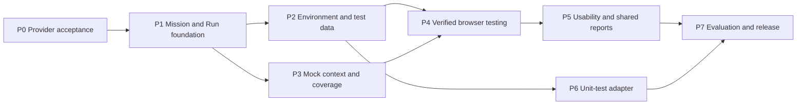

# Centinel Dynamic Development Plan

**Planning baseline:** 7 October 2026; foundation progress updated 13 October 2026

**Status:** proposed delivery plan; estimates and release defaults are recommendations, not confirmed deadlines

**Scope:** JY's Dynamic module and the shared infrastructure it consumes. Static implementation and acceptance are outside this plan; incoming context is supplied by an explicit development stub.

**Authority:** [DESIGN.md](../DESIGN.md) → [PRD](Centinel_PRD_Revised.md) → current feature specifications → technical contracts

## 1. Recommended direction

Finish and accept the shared Codex/provider foundation first. Then deliver one
repeatable, evidence-verified browser mission through the same project identity
and durable records used by Review. Expand that working path into environment
profiles, mocked incoming context, exploratory/regression testing, usability, shared
reports and a separate unit-test runner. Evaluate continuously and finish with
Dynamic release acceptance against a frozen application/data baseline.

The user narrowed this plan on 7 October 2026. The whole-product PRD remains
unchanged: Static is still a separate product area, but its implementation,
provider runs and release gates are not dependencies for this Dynamic workstream.
Use [the incoming-context stub](DYNAMIC_CONTEXT_STUB.md) and
[Cypress Real World App](DYNAMIC_TEST_TARGET.md) as the initial development inputs.
A future real Static export adapter is a separate integration task, not a gate here.

A functioning browser agent is the starting point. The next product milestone
is a test whose inputs, checks, verdict, evidence and rerun history can be trusted.
Native desktop testing stays outside the required release until all core gates
pass and the team explicitly schedules it.

[PROJECT_PLAN.md](../PROJECT_PLAN.md) is historical. Its fixed MiniMax/Gemini
choices, SQLite-first authority and optional collaboration are superseded by the
PRD. This plan preserves API-provider choice, bearer-scoped Supabase authority,
local execution and required member access to results/evidence.

## 2. Current baseline and remaining work

The planning baseline includes commit `5744279` (PRD) and the shared
Codex/provider implementation developed on `codex/shared-codex-provider`. The
user subsequently authorized committing, publishing and merging this foundation
into the default branch (`main`, not `master`). Git/PR history identifies the
integrated revision; integration does not mark the pending live acceptance gates
complete. Future commits and outward-facing actions still require authorization.

| Area | Current evidence | Remaining gate |
| --- | --- | --- |
| Codex provider | Settings connection/model selection, text/image transport, isolated local account credentials, cancellation and HTTP tests exist. Real CLI initialization/account-read succeeded. | Real ChatGPT login, text/image generation and complete Dynamic executions. See [integration record](CODEX_PROVIDER.md). |
| Shared model foundation | Configured API/Codex adapters, authenticated settings and usage ledger wiring exist. | Live provider/account limits, unsuccessful/retried-call accounting, refreshed/expired bearer behavior and packaged launch acceptance. |
| Dynamic prototype | URL/goal input, smoke/journey mode, Playwright loop, screenshots, traces, cancellation and local summaries exist. | Mission revisions, independent checks, policy enforcement, environment/data lifecycle and durable reconciliation. |
| Honest failures | Provider/runtime errors become blocked; cancellation aborts active work; duplicate finding creation was removed. | `finish_success` still finalizes success in the runner; failed-goal findings still use fixed severity/confidence and lack independent verification. |
| Persistence and access | Dynamic routes/files check shared membership; new shared projects can acquire an additive local workspace pointer. | Dynamic records/findings/evidence remain local. Membership checks do not establish cloud synchronization, RLS/Storage acceptance or restart recovery. Duplicate-start handling still needs an atomic contract. |

The preceding implementation reported 325 sidecar tests, 172 frontend tests,
TypeScript/build checks and three viewport checks passing. Those are recorded
local checks, not new tests run for this plan or proof of live authentication,
Storage access, migration safety or final product acceptance.

## 3. Delivery order, dependencies and effort

Each phase ends with a small demonstrable workflow and retained acceptance
results. Create bounded feature specifications/tasks before implementation;
record status as planned, implemented, locally verified, live accepted or blocked.
Do not mark a phase complete just because its code merged.

| Phase | Deliverable | Lead and coordination | Dependencies | Rough effort |
| --- | --- | --- | --- | --- |
| P0 | Accept shared Codex/API foundation and freeze initial contracts | JY | Merged foundation (`3fdb24b`) | 1–2 days |
| P1 | Mission/Run records, shared persistence, safe lifecycle and first verified check | JY; shared schema review | P0 | 4–6 days |
| P2 | Environment profiles, variables, preflight and test-data lifecycle | JY; shared credential boundary | P1 | 4–6 days |
| P3 | Mock incoming context and criterion coverage | JY | P1; development stub | 2–4 days |
| P4 | Reliable browser execution, exploration and regression | JY | P1–P2; P3 for linked requirement coverage | 5–8 days |
| P5 | Usability, reviewable findings, shared evidence and reports | JY; shared findings/report review | P3–P4; P1 private storage | 5–8 days |
| P6 | Existing unit-test framework adapter | JY | P1–P2; can overlap P3–P5 | 3–5 days |
| P7 | Repeated evaluation, packaged acceptance and release evidence | JY | All required Dynamic phases | 5–8 days |
| Extension | Native desktop test adapter | JY; separately scheduled | Core release accepted | Not estimated until OS/app chosen |

Estimates are engineering days for the Dynamic/shared slices: **29–47 days**
with one Dynamic developer, before unexpected platform repairs, external waiting
and contingency. They include mock-context consumption, not Static implementation or real export integration.
Plan roughly **8–12 calendar weeks** if JY works close to full time and shared
reviews/live services are available; part-time availability changes that range.
No submission date or weekly capacity has been supplied, so this is sequencing
and sizing rather than a calendar commitment. Re-estimate after P0 and P1.

Define the evaluation application, seed defects and basic scenarios in P0.
Grow that corpus with every phase; P7 consolidates evidence instead of starting
all testing at the end. Report/evidence schemas are agreed in P0/P1 even though
the complete report workflow lands in P5.

## 4. Phase work and exit gates

### P0 — Accept the provider foundation

**Tasks**

- P0.1 Foundation integrated: PR #2 merged as `3fdb24b`. Retain its validation
  evidence and preserve existing local data; live provider acceptance remains pending.
- P0.2 Run real Codex browser sign-in, model catalog, text and screenshot tests.
  Run one safe Dynamic journey; also exercise API mode.
- P0.3 Exercise disconnected/expired auth, unavailable model/CLI, provider limits,
  cancellation while active/queued and restart/reconnect. Check both Centinel
  bearer identity and the separate local Codex connection.
- P0.4 Agree versioned Mission/Run/check/finding/evidence/report contracts and
  role permissions for Dynamic. Use the pinned Cypress Real World App baseline
  from [the target record](DYNAMIC_TEST_TARGET.md), and create normal,
  seeded-defect and blocked cases. Build consumer fixtures without waiting for Static.
- P0.5 Record packaged-launch CLI discovery requirements; a CLI launched from a
  developer terminal does not establish Tauri installation readiness.

**Exit gate:** actual API and Codex text/image calls work through the configured
adapter; each backend completes an inspected journey with evidence; error/cancel
paths have recorded outcomes. If live credentials or services are unavailable,
record that blocker and proceed with independent contract/fixture work without
labeling provider integration accepted. Model-declared success remains provisional
until P1's independent check is in place.

### P1 — Mission/Run, persistence and trustworthy lifecycle

**Tasks**

- P1.1 Specify `Mission`, immutable `MissionRevision`, `Run`, `CheckResult`,
  `EvidenceManifest` and audit records. Separate execution state, check verdict,
  finding verification and remediation. Add optional/new fields without breaking
  existing session endpoints or Review contracts.
- P1.2 Implement a Dynamic repository boundary. Make shared metadata, decisions
  and findings authoritative in bearer-scoped Supabase; keep browser processes
  and recoverable temporary evidence local. Use additive migrations and private
  Storage policies; preserve historical SQLite data and mark unverified legacy
  fields unavailable. Make migration/import repeatable and separately authorized.
- P1.3 Add atomic start idempotency, per-project/run execution locks, ownership,
  heartbeats/lease expiry and startup reconciliation. Double-clicking Start
  creates one Run; process interruption cannot leave a false running/pass state.
- P1.4 Persist evidence manifests with hashes, upload state and authorized access.
  Failed upload retains recoverable local evidence and shows incomplete sharing.
  Reuse the existing Review refresh/recovery patterns only after checking their
  applicability; do not share a stale user's client or execution lease.
- P1.5 Implement one deterministic criterion (visible text or expected URL) and
  an independent checker. A model's terminal proposal cannot finalize a pass.
  Incomplete required checks stay uncertain/not tested. Failed checks create
  candidate observations, without invented severity or confirmation.
- P1.6 Add the basic code-enforced action/origin/workspace policy before any
  automated setup command is introduced. Retain cancellation and partial evidence.

**Exit gate:** a new shared project owns one mission with two independently
recorded runs; a known pass and a seeded failed check are verified by evidence;
provider/browser errors remain blocked. Concurrent duplicate starts produce one
run. Restart reconciles interrupted work. An authorized second member can read
synced run metadata/evidence; a non-member cannot. Legacy data is still readable.

### P2 — Environment profiles and test-data lifecycle

**Tasks**

- P2.1 Save reusable profiles: target URL, allowed origins, account role/session
  reference, browser/viewport, required configuration and budgets. Freeze a
  sanitized profile snapshot per Run; store secret references, never raw values.
- P2.2 Compare variable names/prerequisites with `.env.example`, package scripts
  and explicit project metadata. Suggest local startup commands and missing
  names; never invent secret values or execute suggestions automatically.
- P2.3 Add preflight: target reachability, required configuration, account/session
  readiness, provider/model/image capability, authorized workspace and data lock.
  Missing prerequisites produce actionable blocked reasons before browser work.
- P2.4 Support manual preparation first, then explicitly configured setup/cleanup
  hooks. Record setup, run and cleanup outcomes separately. Restrict hooks to an
  authorized workspace, approved command definition, timeout and output budget;
  target-app content/model text cannot supply arbitrary shell commands.
- P2.5 Use run-specific data identifiers or an exclusive profile/data lock.
  Always attempt configured cleanup after success, failure or cancellation;
  persist cleanup errors and a recovery instruction. A pending cleanup lock
  cannot expire silently and expose dirty data as a clean initial state.
- P2.6 Redact seeded tokens/passwords and sensitive URLs in prompts, traces,
  screenshots where necessary, uploads and exports. If sensitive visual content
  cannot be safely captured, exclude/block it and disclose missing coverage.

**Exit gate:** repeat the same mission twice from a documented equivalent initial
state. Example: prepare a test account and a unique `qa_<runId>` item, execute the
journey, remove that run's item, and verify cleanup. Simulate missing variables,
unreachable target, cleanup failure and concurrent data reuse. Secrets do not
appear in retained or provider-bound observations. Cleanup failure does not
rewrite the functional check result, but blocks unsafe reuse until resolved.

### P3 — Mock incoming context and coverage

**Tasks**

- P3.1 Consume the proposed versioned `IncomingContextSource` boundary through
  `createStaticContextStub`. It supplies project, synthetic Review/snapshot IDs,
  approval/currency state, source versions, requirements, criteria and risk hints.
  See [stub contract and usage](DYNAMIC_CONTEXT_STUB.md). No Static scan or export
  implementation is part of this phase.
- P3.2 Select criteria and edit a generated mission before execution. Preserve
  the exact input snapshot and its `mock-static` provenance in mission revisions,
  Runs and reports. Keep criteria IDs separate from browser check implementations.
- P3.3 Handle normal, stale, conflicting, unapproved, incomplete and absent inputs.
  Test cross-project and dangling-reference rejection at the future consumer
  boundary; caller-supplied project IDs in a stub are not authorization.
  Permit attributable use of pending context without calling it real approval.
- P3.4 Map criteria to independently verified checks and a declared denominator.
  Show passed, failed, blocked, uncertain, not-tested and excluded states with
  reasons. Later source/revision changes cannot rewrite earlier coverage.
- P3.5 Keep manual missions working with no context. The stub must be explicitly
  injected in development/tests, never a fallback for a failed live service.
  A future real adapter can implement the same consumer boundary after a
  separately scheduled schema agreement and integration acceptance.

**Exit gate:** load the normal mock snapshot, select a criterion, create a mission,
execute it on the real local target and link actual browser evidence to the exact
mock criterion. Exercise all exceptional fixtures and changed revisions; retain
old results. Reports label synthetic source context while browser outcomes are
real. No Static service or live Review is required for this gate.

### P4 — Browser execution, exploration and regression

**Tasks**

- P4.1 Split observation, planning, policy guard, action execution and checking
  into focused modules. Observe DOM/accessibility first, use screenshots where
  needed, and record coordinate fallback when a stable locator is unavailable.
- P4.2 Extend independent checks to supported text/URL/element/form-state outcomes;
  add relevant console/network observations. Re-observe after actions and require
  evidence for terminal decisions. Missing observability yields uncertainty.
- P4.3 Enforce origin policy for clicks, redirects, popups, downloads and uploads,
  plus configured destructive-action restrictions. A natural-language warning
  in the prompt is not the enforcement mechanism.
- P4.4 Bound steps, wall time, retries, provider calls and available usage budgets.
  Distinguish safe re-observation/retry from repeating non-idempotent submissions.
  Cancel active navigation, model calls and backoff; retain partial evidence.
- P4.5 Implement bounded exploratory missions with visited-state/action records,
  selected objectives and disclosed unvisited scope. Do not imply exhaustive
  exploration because a step budget was exhausted.
- P4.6 Implement saved-mission regression: pin mission revision and relevant
  environment/target version; create a new Run and relate repeated observations
  to earlier findings. A successful retest does not erase prior evidence.

**Exit gate:** normal and deliberately defective login/form/CRUD flows are
distinguished from provider outages, unreachable pages and ambiguous outcomes.
A misleading `finish_success` cannot bypass a required failed check. Unsafe
redirects/actions are stopped, repeated submissions are not blindly replayed,
and cancellation/restart retains accurate state. Exploration exposes gaps;
regression after a seeded fix preserves both runs and finding lineage.

### P5 — Usability, findings, collaboration and reports

**Tasks**

- P5.1 Start with a small explicit usability rule/persona set: labels, keyboard
  reachability, focus/feedback and error recovery for chosen journeys. Separate
  deterministic checks from subjective suggestions; persona simulation is not a
  real-user study or a claim of complete accessibility conformance.
- P5.2 Reuse the existing shared findings vocabulary for Dynamic and record expected/actual result,
  reproduction steps, evidence, category, severity, priority, confidence basis,
  verification decisions and remediation history. Correlate repeated observations.
- P5.3 Add attributable confirm/reject/needs-investigation review. Reuse shared
  role enforcement; do not invent a new owner/reviewer permission model silently.
  Keep Dynamic findings separately labeled in Project Assessment until an
  explicit, tested cross-module risk aggregation policy is accepted.
- P5.4 Finish private evidence sharing, upload recovery, retention handling and
  member/revocation tests. A second device can inspect fully synced results;
  local-only/incomplete uploads remain visibly unavailable there. Offline exports
  already downloaded by a recipient cannot be remotely revoked.
- P5.5 Generate versioned report snapshots, JSON plus Markdown/PDF using existing
  renderers where compatible. Include scope, source/target/environment versions,
  mission revision, checks, findings, actor/reviewer, setup/cleanup, untested areas,
  evidence availability and actual available usage. Validate export contents and
  links; do not treat a local summary file as complete shared reporting.
- P5.6 Apply DESIGN.md to complete Dynamic setup/activity/result views. Keep
  advanced controls/logs progressively disclosed, map statuses honestly and
  verify keyboard/focus and the required three viewport sizes.

**Exit gate:** a second authorized member can inspect, review and reproduce a
reported issue from its evidence/report. A non-member and revoked member cannot
retrieve protected metadata/files or start work. Usability findings expose their
rule/persona and evidence. Reports disclose omitted/unsynced evidence and preserve
snapshot history instead of silently changing after later runs.

### P6 — Separate existing unit-test execution

**Tasks**

- P6.1 Use **Vitest** as the first supported target-project framework. The pinned
  Cypress Real World App uses it in `test:unit:ci`; verify machine-readable
  output against the installed target version in P0.
  This does not promise Jest, pytest or other framework support.
- P6.2 Implement a separate runner interface with authorized workspace, explicit
  executable/arguments, timeout, cancellation, bounded/redacted output and a
  machine-readable result parser. Do not pass a model-generated shell string
  through an unrestricted shell or auto-install target dependencies.
- P6.3 Record framework/version, command, workspace/target version, exit/signal,
  test counts, per-test failures, logs and execution outcome. Treat invalid
  configuration, missing dependencies, parser errors and no tests collected as
  explicit outcomes, never as a passing suite.
- P6.4 Expose unit runs through compatible shared Run/evidence/report contracts,
  while keeping framework test results separate from browser journey checks.
  Generated unit tests are an extension, not part of this phase.

**Exit gate:** a fixture project produces passing and failing test results,
runner/configuration failure and cancelled/timeout cases. Counts/logs match the
framework output; cancellation terminates active work and workspace escape is
denied. All outcomes appear correctly in history and reports.

### P7 — Evaluation and release acceptance

**Tasks**

- P7.1 Freeze the authorized app commit/deployment, requirements, seeded data,
  accounts, known in-scope defects, manual/scripted baseline, model/backend and
  evaluation protocol. Choose repeat counts and metric thresholds before scoring.
- P7.2 Run the Dynamic and shared-runtime parts of the PRD acceptance scenarios.
  Replace any Static ingestion/Review preparation with an explicitly synthetic
  incoming snapshot. PRD scenarios 1–2 (Static Review/source updates) are outside
  this workstream; scenario 4 uses mock context. Scenarios 3 and 5–14 remain
  Dynamic/shared acceptance gates. Do not claim whole-product or real Static integration
  acceptance. Track local verification and live Dynamic acceptance separately;
  retain exact versions, evidence and blockers for every applicable scenario.
- P7.3 Measure task completion, criterion coverage, finding precision/recall where
  ground truth permits, evidence completeness, repeatability, recovery, elapsed
  time, interventions and available usage. Report blocked/cancelled runs and
  exclude no failures silently; disclose corpus and observability limits.
- P7.4 Exercise real two-user RLS/Storage isolation, expired/refreshed/revoked
  access, cancellation, process kill/restart, offline upload recovery, duplicate
  starts, failed cleanup and seeded-secret redaction. Validate the packaged Tauri
  app on a documented OS, including Codex executable discovery.
- P7.5 Produce the demo script, setup guide, evaluation tables, release checklist
  and known limitations. Gate release on required scenarios or explicitly agree
  a scoped release with visible blockers; never report blocked work as complete.

**Exit gate:** repeat mock context → mission → real browser checks → human
finding review → Dynamic report on the fixed baseline, demonstrate
unit results and both model backends, and produce reproducible evaluation
records. Native desktop work begins only after this gate and an explicit scope
choice for OS, target applications, permissions and time budget.

## 5. Incoming-context boundary and selected test target

Static analysis, document ingestion, source-code review, requirement extraction,
Static reports and Static release acceptance have no tasks in this plan.
Dynamic uses the [development stub](DYNAMIC_CONTEXT_STUB.md) to simulate received
requirements/criteria/risk hints. Shared auth, membership, provider, findings
vocabulary and storage remain necessary Dynamic dependencies.

The selected external application is [Cypress Real World App](DYNAMIC_TEST_TARGET.md).
Its source commit, local prerequisites, data reset constraints, scenario matrix
and unit-test entrypoint are recorded separately. Pin the baseline before
measurement; retain defect patches and ground truth independently of model input.
Local target setup, inspected login/payment/logout workflows and upstream unit
baseline passed on 13 October. Autonomous provider acceptance remains pending.

## 6. Suggested release defaults to confirm in P0/P1

| Decision | Proposed default | Change when |
| --- | --- | --- |
| First target | Local Cypress Real World App at the pinned commit; seeded login and payment workflows | Baseline setup proves unsuitable or more representative coverage is required |
| Concurrency | One active Run per project; parallel projects only with separate data/profile resources | Locking and evaluation show safe independent execution |
| Initial browser budget | Preserve existing 15-step default, 25-step cap and five-minute runtime initially | Fixed-case evaluation justifies a different recorded budget |
| Test-data setup | Manual first; optional explicitly configured hooks next | A fixture/seed API enables repeatable authorized automation |
| Unit framework | Vitest (`test:unit:ci` in the pinned target), one machine-readable format | Explicitly expand beyond the initial adapter |
| Secrets | Local protected references; sanitized shared snapshots; no credential roaming by default | A separately specified secure sharing mechanism is required |
| Reports | JSON plus human-readable Markdown/PDF; reuse compatible existing services | Detailed report spec documents another supported export |
| Finding risk | Reuse existing explicit vocabulary/policy; do not invent missing historical values | A reviewed policy change has evidence and migration coverage |
| Retention and execution roles | Decide with the shared owner before enabling shared uploads/hooks | Organization/privacy requirements demand stricter policy |

## 7. Immediate backlog: next development slice

The next slice is **mock context + target preparation → P0 acceptance → P1 contracts → one verified rerunnable mission**.
Do not start a broad Dynamic UI redesign before those contracts are stable.

| Order | Task | Concrete result |
| --- | --- | --- |
| 1 | Record merged foundation; prepare mock input and target | Foundation merged as `3fdb24b`; stub exists; install and verify the pinned external target in a separate workspace |
| 2 | Complete real Codex/API acceptance | Text + screenshot + one journey per backend; record live blockers separately |
| 3 | Write Dynamic runtime/data specification | Versioned DTOs, mock-context injection, state transitions, idempotency/locks, auth/storage and legacy-data compatibility |
| 4 | Add MissionRevision/Run/check repositories | Additive schema plus compatibility adapter for existing sessions; preserve old data |
| 5 | Guard duplicate starts and reconcile restarts | Atomic single-start behavior, actor/lease records, durable stopped/interrupted outcomes |
| 6 | Implement visible-text/URL criterion verification | Known pass, seeded failed check, misleading model terminal proposal and provider-blocked cases |
| 7 | Wire the smallest mission/history/evidence UI | Create mission, run twice, inspect independent results and authorized synced evidence |

Definition of the first demo: one shared project, explicit mock input, one reusable mission, two runs,
one criterion-backed pass, one seeded failure, accessible evidence and a cancelled
or provider-blocked example. Reports can initially expose the agreed structured
snapshot; complete presentation/export remains P5.

## 8. Requirement coverage and release gates

| Requirement group | Primary phase/track | Acceptance emphasis |
| --- | --- | --- |
| DYN-01, DYN-02, DYN-03, DYN-04 | P2; provider readiness P0 | Profiles, configuration, preflight and setup/cleanup |
| DYN-05, DYN-13 | P3; consumer checks P4 | Pinned mock context and criterion coverage; real Static adapter acceptance deferred |
| DYN-06 | P1 | Mission revisions and independent immutable runs |
| DYN-07, DYN-08, DYN-09, DYN-10 | P1 + P4; recovery P7 | Controlled execution, verified outcomes, modes and restart/cancel behavior |
| DYN-11, DYN-12, DYN-14, DYN-15 | P5; persistence/access P1 | Usability, reviewable findings, reports and collaboration |
| DYN-16 | P0; final acceptance P7 | Real API/Codex image/action/error/cancel flows |
| DYN-17 | P6 | Existing unit tests through one framework adapter |
| DYN-18 | Extension only | Native desktop adapter with separate OS/app acceptance |
| SHR-01, SHR-02, SHR-03 | P0/P1 + P3/P5/P7 | Verified identity, membership, stable references and live isolation |
| SHR-04 | P1/P2; adversarial checks P7 | Protected secrets and redacted observations |
| SHR-05 | P1/P4/P5 | Audit, idempotency, reruns and finding correlation |
| SHR-06 | P0/P4; evaluation P7 | Actual usage, retry/failure accounting and enforceable budgets |
| SHR-07, SHR-08 | P1/P5 | Explicit risk semantics and versioned portable reports/evidence |
| NFR-01, NFR-02, NFR-05, NFR-06, NFR-07 | P1–P7 | Bounded, reproducible, maintainable and compatible execution |
| NFR-03, NFR-04 | P1/P2/P5/P7 | Access/privacy and DESIGN.md accessibility/layout checks |

For every implementation slice: use focused tests during development, then the
smallest complete relevant suite. Run frontend build, relevant tests and the
three required viewport checks for UI changes. Test migrations against a
representative non-production copy, including restart/idempotency and preservation
checks. Live provider/RLS/Storage and packaged-app acceptance are separate from
mock-based or local unit tests.

## 9. Scope control and outstanding inputs

Required Dynamic release scope remains Web journeys/smoke/exploration/regression,
usability, environments/test-data lifecycle, mocked incoming context, collaboration,
reports, existing unit tests and selectable Codex/API modes. Codex is optional
for an individual run but supporting the mode remains a required deliverable.

Native desktop testing, generated unit tests, heatmaps, a browser farm and broad
CI/CD integration do not displace required work. If time is short, reduce the
number of supported browsers, personas, frameworks and evaluation journeys
explicitly; do not silently remove a PRD requirement or call an unverified
prototype a complete release.

Before assigning calendar dates, obtain the final demo/submission deadline,
JY's actual weekly availability, local target setup results and live
Supabase/provider access. The initial app and unit framework are selected above. These inputs refine estimates; they do not block starting
contract design, fixture preparation and the reviewable next slice above.

## 10. Foundation progress — 13 October 2026

[Local target baseline](DYNAMIC_TEST_TARGET.md) is verified: fixed checkout,
Node 22.20.0, running frontend/backend, 44 passing upstream unit tests and 10
skipped tests, inspected login/payment/logout paths and retained evidence.

[Mission/Run/Checker foundation](DYNAMIC_MISSION_RUN_FOUNDATION.md) is implemented:
immutable revision snapshots, explicit mock-context authoring, separate Run state
and verdict, atomic idempotency/active-run SQL, cancellation-safe transitions,
three independent check kinds, local hashed evidence, authenticated backend
routes and a bridge to the existing browser runner. A scripted real-browser demo
produced separate passing/failing Runs; the controlled failure is not an upstream
defect. Blocked/cancelled demo cases are synthetic. It uses an explicit test
repository and does not establish provider or cloud acceptance.

Local verification: 355 sidecar tests and TypeScript passed; additive migration
applied twice successfully in isolated PostgreSQL; SQL lifecycle/RLS/actor checks
and two-connection concurrent-start acceptance passed. No frontend UI changed.

Later on 13 October, [local runtime setup](LOCAL_RUNTIME_SETUP.md) connected the
existing Centinel Supabase project and, with explicit approval, applied this one
migration. An expressly authorized QA identity passed real Codex text/image
checks and one authenticated Web smoke Mission with durable passed results and
readable local evidence. Duplicate request replay and basic access denial also
passed. This accepts the bounded Codex path, not all P0/P1 gates.

The next slice is now locally implemented: a saved-test/revision/history UI,
independent result/evidence display, worker leases, heartbeat and expired-worker
reconciliation. The recovery migration `202610130002` passed isolated PostgreSQL
checks and repeat application, then was applied to Centinel Supabase with explicit
user approval. Migration history/RLS/RPCs were verified and the local worker
was restarted.
Recovery is project-scoped on first authenticated access, records interruption
without automatically replaying actions, and fences late worker completion.

Current verification: 363 sidecar tests, 179 frontend tests, sidecar TypeScript,
frontend production build and `git diff --check` passed. The build retains the
existing large-chunk warning. The
frontend's first all-suite run under simultaneous sidecar load had two Review
loading failures; both isolated tests and the subsequent complete frontend run
passed. Real QA-bearer history/local screenshot display and 1440×900, 1200×900,
390×844 layout checks passed against the existing live foundation backend. A new test
was also saved and started through the UI; configured Codex execution completed
with an independently checked passed verdict persisted to Supabase.

Live QA-bearer lease acceptance passed after deployment: claim/renewal, healthy
worker preservation across an actual sidecar restart, natural expiry recovery,
old completion rejection, immutable recovery and idempotent replay without
execution. A subsequent real Codex browser smoke completed with a recorded
lease, two independent passed checks and two evidence entries. This
infrastructure fault-injection Run submitted no browser actions;
active browser crashes remain a broader gate. See [runtime setup](LOCAL_RUNTIME_SETUP.md).

Next: begin P2
with reusable environment profiles and read-only preflight, followed by manual
test-data preparation/cleanup records. API-mode journeys, private evidence
synchronization, richer checks, credential references and complete action/origin
policy remain separate gates. This does not mark P1 complete.

## 11. Environment progress — 13 October 2026

[Environment profile/preflight slice](DYNAMIC_ENVIRONMENT_PROFILES.md) implements
shared versioned profiles, encrypted account-scoped local variables, bounded
read-only preflight and immutable Run conditions. Its additive migration was
locally verified and applied under the user's ongoing milestone authorization.
A real UI flow produced a blocked Run for a missing name, then an independently
passed Codex Run after preparation, and preserved the old profile snapshot after
an edit. Browser authentication injection and setup/cleanup are follow-up work;
this slice does not mark P2 complete. PR/merge status is tracked in
[development progress](DEVELOPMENT_PROGRESS.md).

## 12. Manual data lifecycle progress — 13 October 2026

[Manual preparation/cleanup](DYNAMIC_DATA_LIFECYCLE.md) records the baseline,
actor, exact profile version and cleanup separately from functional verdicts.
Environment-backed execution acquires an atomic dirty-data lock; stopped work
requires explicit cleanup, failed cleanup stays locked, and profile edits invalidate
old readiness. The additive migration was locally verified and applied. Live
QA-bearer/UI acceptance demonstrated failed cleanup, blocked reuse and two
independently passed read-only smoke Runs from equivalent recorded preparation.
Workspace hooks, credential/session handling and redaction remain P2 follow-ups.
