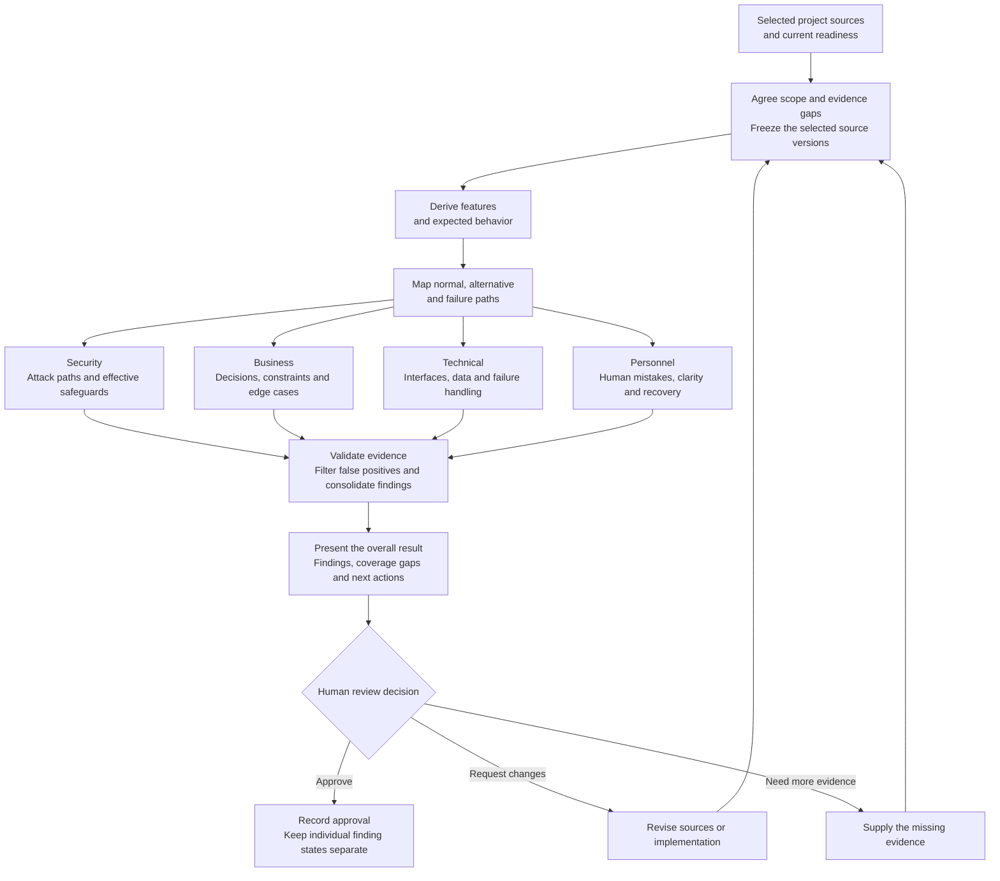

# Proposed Review workflow

Status: proposed workflow for discussion. This document does not implement a new Review orchestrator or change approval gates. The four domains follow the user's agreed proposal, including security attack paths and safeguards against human error. Readiness implementation and outcome validation are a separate workstream.

Readiness informs the scope and records evidence limitations. It does not silently become a new universal gate requiring every documentation category to be Completed. If essential evidence for the requested review is absent, that part is blocked or explicitly unverified; another supported scope may be agreed. Updated sources produce a new frozen review iteration rather than rewriting an earlier review.

## Deriving feature paths from technical evidence

The diagram the user may have in mind is a **Control Flow Graph (CFG)**: it represents possible execution branches and supports reachability questions, including whether an operation is reachable without passing a guard. [CodeQL's control-flow documentation](https://codeql.github.com/docs/codeql-language-guides/analyzing-control-flow-in-python/) demonstrates these questions. A CFG alone does not identify user features or show every cross-service interaction.

The proposed technical basis combines several views:

| View | Role in deriving and reviewing a feature |
| --- | --- |
| Requirements, design and UI/API entry points | Establish intended goals, decision rules and feature boundaries. An inferred feature stays provisional until its supporting sources are identified. |
| Parsed syntax and call relationships | Locate handlers, invoked functions, background jobs and affected components. Unsupported languages and unresolved dynamic calls remain coverage gaps. |
| Control Flow Graph | Expose branches, guards, alternative routes, exceptions and reachability within the supported execution model. Connect function-level graphs through resolved call relationships. |
| Data flow and taint tracking | Follow relevant inputs or sensitive values to operations and outputs, including transformations, validation and sanitization. [CodeQL's data-flow guide](https://codeql.github.com/docs/writing-codeql-queries/about-data-flow-analysis/) distinguishes local, global and taint flow. |
| Feature state transitions | Connect UI actions, API outcomes and persisted state: pending, confirmed, cancelled, failed, restored, retried and other project-defined states. This supports business and human-error review. |
| Trust boundaries and deployment evidence | Locate controls enforced outside application code, including gateways, worker infrastructure and storage policies. Unavailable configuration stays unverified. |

A **Code Property Graph (CPG)** is a useful unifying representation: it combines syntax, control flow and data dependencies, as described by [Joern](https://docs.joern.io/code-property-graph/). This is a proposed analysis architecture, not a decision that Joern or CodeQL has already been installed or integrated.

For each derived feature, retain source-backed entry points, operations, branches, state transitions and unresolved edges. Security queries ask whether a sensitive operation is reachable without the required effective control, or whether untrusted/sensitive data reaches an unsafe destination. Personnel queries ask whether a consequential state transition can happen accidentally and whether a suitable decision or recovery path works. Business and Technical use the same feature map with their own checks.

Graph reachability is a potential path, not automatic proof of a feasible exploit. Check applicable branch conditions and call context; bounded symbolic reasoning or scoped runtime checks may help verify a candidate. Loops, dynamic dispatch, reflection, concurrency and external services prevent a blanket claim that every possible path was enumerated. Mark these limitations explicitly; retain witness paths and their source versions for reported issues.

## What each stage produces

| Stage | Observable output |
| --- | --- |
| Scope and sources | Source/version manifest, requested review boundaries, current readiness gaps and unsupported evidence. |
| Feature derivation | Feature inventory linked to requirements, UI/API entry points and implementation; unresolved mappings remain explicit. |
| Path mapping | Normal, alternate, failure and recovery paths, plus unresolved code or deployment edges. |
| Domain assessment | Per-feature checks with the relevant domain, expected safeguard/behavior and its basis. The user's rate-limit and delete/undo examples are references, not universal rules. |
| Evidence validation | Deduplicated findings with a concrete scenario, source path/location, concise evidence, impact, recommendation and candidate/confirmed basis. JSON data nesting and environment references are treated according to their actual meaning. |
| Review summary | What was reviewed, overall outcome, blockers and unverified coverage, and the next action. Automated completion remains separate from human approval. |
| Human decision | Persisted approval, requested changes or a request for evidence; individual findings retain their own dispositions. |

Activity messages explain the purpose, feature/domain, kind of issue found and next check in concise engineering language, with links to finding details. They expose evidence summaries rather than private model reasoning.

## Workflow acceptance criteria for later implementation

- Every derived feature has source evidence or an explicit provisional label; unknown business intent is never invented from names alone.
- Each reported path has the relevant entry, operation/outcome, conditions and evidence; unresolved edges cannot be reported as protected or tested.
- Security, Business, Technical and Personnel checks share the feature map while retaining their distinct questions and evidence.
- Confirmation, undo and rate limiting are evaluated in context. Their mere presence is insufficient, and an equivalent effective safeguard is not falsely rejected.
- Validation distinguishes potential reachability, evidence-backed defects and observed runtime behavior. Unsupported or unexecuted checks stay unverified.
- Summary and decision use the frozen review's actual findings and limitations. Approval does not resolve findings or certify exhaustive security.

Related proposal: [Review domains and false-positive controls](REVIEW_DOMAINS_FALSE_POSITIVES_PROPOSAL_2026-10-19.md).
