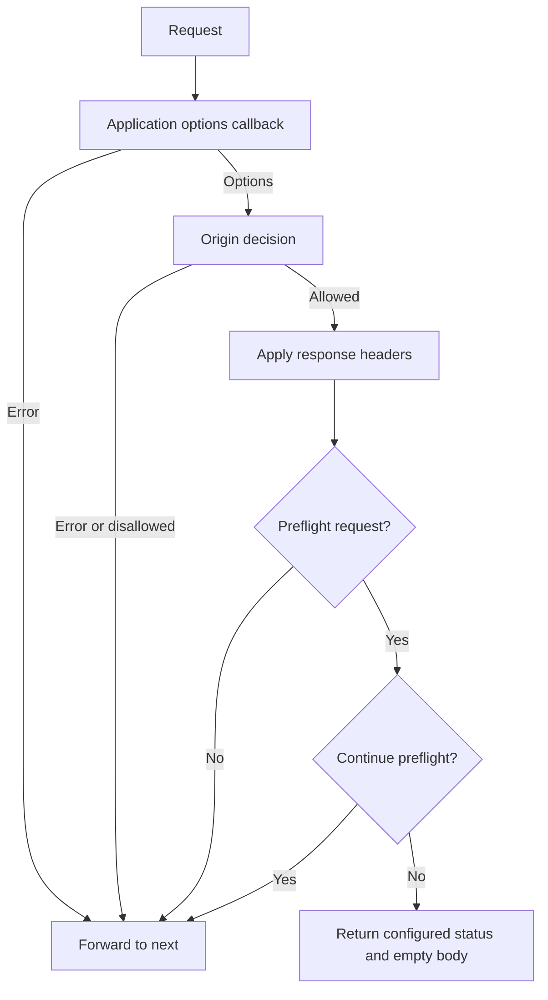
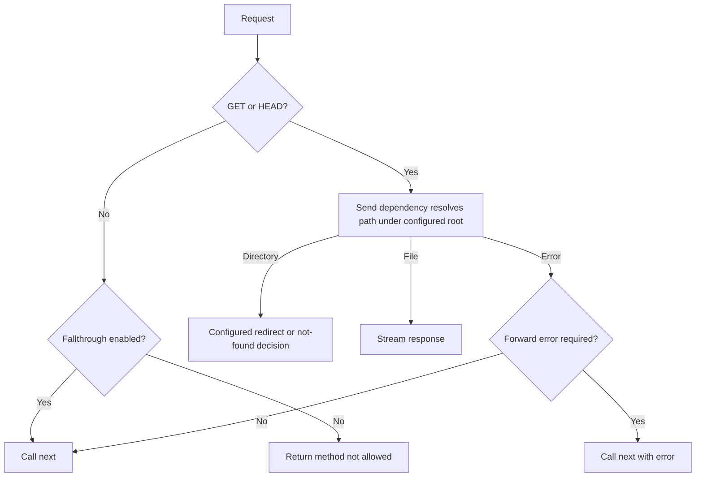

# Public repository AI assessment execution

The user explicitly resumed AI assessment after the earlier usage hold. The installation hold was changed to `CENTINEL_AI_ASSESSMENT_PAUSED=0` and the verified workspace sidecar restarted. Use the configured Codex provider and existing signed-in Centinel session, without copying authentication or changing providers.

## Execution and acceptance

- Assess **CORS Public Acceptance** and **Serve Static Public Acceptance** sequentially through the normal live readiness workflow.
- Compare category states and source-backed gap explanations with the agreed readiness criteria. File count and filename alone are not completeness measures.
- Start one explicit scoped production Review per project using the objectives and measurable checks in [the public reference report](PUBLIC_REPO_REFERENCE_2026-10-19.md).
- Inspect saved activity, findings, source provenance and model execution outcome. Validate reported issues against the unchanged public source, distinguishing code defects, documentation gaps, heuristic warnings and provider errors.
- Preserve human approval. Do not approve reviews, change finding dispositions or publish upstream comments automatically.
- A completed workflow is not proof of semantic accuracy, exhaustive security coverage, build success or runtime execution. The earlier 11-case model corpus and Windows Dynamic limitations remain separate acceptance work.

## Results

Live execution results are recorded below; a successful model connection alone is not assessment acceptance.

- CORS live readiness completed: Repository Completed; Requirement specification Incomplete; Design documentation Completed; Coding standards Completed. Gap validation is in progress.
- The CORS gap is **Evidence is needed for scope**. Its evidence references the imported README/configuration options and callback/preflight tests at saved source versions. Those quotations exist in the unchanged public checkout. This is an unverified-completeness result, not proof that a particular business rule is defective. Completed design/standards labels are the live engine's output; a full independent criterion-by-criterion semantic acceptance score is not claimed from the compact UI alone.
- Found and corrected an execution defect before the live Reviews: the saved objective was used in retrieval but absent from the final model prompt. The prompt now contains the reviewer objective and full artifact paths, treats source text as untrusted evidence, and requests concrete actionable behavior. New Reviews carry `review-2026-10-20-objective-v1` in their config; resolution eligibility requires matching current model-policy versions, so a legacy/changed-policy comparison cannot automatically resolve findings. Focused orchestrator, harness, correlation, reconciliation, iteration and authenticated HTTP checks passed **125 tests / 6 files**; sidecar TypeScript passed. No existing Review history was rewritten.
- Started **CORS public workflow — origin and preflight review**, visible identifier `#51a47438`, in project `ec1a5131-5a25-418c-9010-7c6a56106b7f`, with all 15 imported artifacts and the point-form objective. Its source stage read all 15 files and surfaced a business-requirement confirmation gap. The README remains source evidence rather than an automatically confirmed requirement record; this limits formal requirement traceability without preventing the requested code/document review.
- CORS Review reached **Need Approval** in **1m 49s**: 7 deterministic nesting warnings, 1 model finding and 1 business-requirement evidence gap, 9 displayed findings total. Stage timings were 26s source/document checks, 15s context, 31s deterministic checks, 31s model review and 2s finalization (stage totals are not a promise to equal end-to-end timing).
- The saved CORS Playground trace confirms one successful `codex` / `gpt-5.6-sol` model attempt: **30,739 ms**, **35,463 input tokens**, **912 output tokens**. These are execution ledger values, not estimated cost. All five orchestration stages completed; loading formal traceability was explicitly Not recorded. The model-attempt screenshot/text and finding screenshot are saved under `evidence/public-repositories-ai-2026-10-20/`.
- The model finding **Global or sticky origin regular expressions produce state-dependent CORS decisions** points to imported `lib/index.js:30`, finding prefix `#310c288c`. Source inspection confirms the direct `allowedOrigin.test(origin)` call and README support for RegExp origins. `node scripts/cors-regexp-verification.mjs` reproduced the actual unchanged source helpers: identical-origin results were `[true,false,true]` for global, sticky and array/global patterns, versus `[true,true,true]` for an ordinary pattern. This confirms a function-level behavioral defect, not an independently demonstrated authorization bypass or HTTP deployment exploit. No upstream source or live finding disposition was changed.
- Started Serve Static readiness only after CORS Review was terminal, keeping live model work sequential.
- Serve Static live readiness completed with **all four categories Completed**. Its subsequent Review still needs to preserve the distinction between source-discovered behavior and formally confirmed requirement records. The all-Completed result is not a claim that the unimported `send` implementation or excluded extensionless files were assessed.

## Serve Static completed Review

The retry **Serve Static public workflow — file and error paths (Retry)** (`#22c9c308`, project `e0a5af49-70d4-43ab-ae9c-121ed2c62a58`) reached **Need Approval** in **1m 52s**. All 18 source reads succeeded. Recorded stages: source 30s, context 17s, deterministic 19s, model 40s, finalization 1s. Seven displayed findings comprise five deterministic warnings (two test-nesting warnings and three CLI `console.error` warnings), one model finding and one confirmed-business-requirements gap. None was automatically dismissed, resolved or approved. The saved Playground confirms one successful `codex` / `gpt-5.6-sol` attempt: **39,633 ms**, **32,703 input tokens**, **1,270 output tokens**; no provider failure or retry was recorded for that model step.

Model finding **Supplied snapshot omits fixtures required by the imported tests** (`#d23ad075`, `test/test.js:62`) explicitly describes a snapshot/traceability gap, not a confirmed middleware defect. Independent inspection verifies that the upstream tracked checkout contains `test/fixtures/foo bar` and `test/fixtures/.hidden`, referenced by URL-encoding/dotfile tests, while the live import inventory excludes them. Therefore the source location is valid and the limitation is real; it is a Centinel import-scope limitation rather than missing upstream files. Full upstream tests were not executed. Existing CLI diagnostic messages are heuristic warnings, not demonstrated debug/secret leakage. No new TODO warning was generated for `todo.txt`.

## Evidence-gate regression found during Serve Static execution

The first Serve Static Review (`#5ce5ca2b`) stopped after reading all 18 artifacts, before any model request. The detector interpreted JavaScript test names under different option settings as seven contradictory requirements (for example, including versus excluding `Accept-Ranges`). It also treated “without slash” as negative polarity. These were false blockers, not demonstrated repository defects.

Automatic contradiction claim extraction now uses document prose, excluding source-code artifacts/code extensions, configuration strings, Markdown fenced and indented examples. Original document line numbers and real prose conflicts remain detectable. Explicit/confirmed requirement claims are still assessed separately, including when their provenance is code; code remains available to ordinary Review analysis. This is a conservative boundary, not a complete language/context parser. Human review remains necessary for conditional prose and ambiguous conflicts.

Review policy is now `review-2026-10-20-prose-evidence-v2`; incompatible/legacy policy comparisons cannot derive resolution merely from an absent finding. Final focused verification passed **159 tests / 8 files** (grounding, orchestrator, retry, harness, correlation, reconciliation, iteration and authenticated HTTP), sidecar TypeScript and scoped whitespace checks. The original blocked execution remains immutable; the UI retry created `#22c9c308` under the corrected policy without fabricating manual evidence decisions.

## Fixed real-model readiness corpus

The full 11-case corpus was started sequentially after both public Reviews finished, using the unchanged `readiness-2026-10-19.4` policy and independently labelled fixtures. Corpus SHA-256: `07371a0a91bd07cf7e5df89f953ad50b1541efdf30a250d5b0de67d5c48b48a1`. The earlier single-case report was preserved as `live-codex-results-before-full-corpus-2026-10-20.json`.

- **complete-all-categories: Passed.** Requirements, design and standards all Completed; all criterion states, explanations, source inventory and evidence checks passed.
- **missing-category: Passed.** Requirements/design Completed and standards Missing, matching the fixed labels; all criterion states and evidence validity checks passed.
- **vague-requirements: Blocked by provider rate limit.** The runner recorded `rate_limited` / `provider_or_engine_error`, no category states, and stopped without sending the remaining eight cases. This is not an incorrect Missing/Completed documentation outcome or a successful semantic assessment. The older isolated pass does not turn this full run into a pass.

Thus **2/11 cases passed in this run, 1 could not execute successfully and 8 were not attempted**. Among the two successfully assessed cases there were no overclaimed Completed states, false Missing states, missed criteria, invalid citations/bases or engine/model state disagreements. Alternative valid quotations differed from some gold excerpts; these diagnostic differences do not count as semantic failures. Full corpus acceptance remains open. Reports: `evidence/readiness-outcomes-2026-10-19/live-codex-results.json` and `evidence/public-repositories-ai-2026-10-20/readiness-corpus-partial.json`. No gold labels were altered and no project state was written by the fixture runner.

## Acceptance status

| Feature | Acceptance criteria | Status | Risk flags |
|---|---|---|---|
| CORS live readiness | Persist four category outcomes and source-backed gaps | Workflow passed | Requirements Incomplete; independent semantic accuracy not fully certified |
| Serve Static live readiness | Persist four category outcomes | Workflow passed: all Completed | Excluded extensionless/dotfile fixtures and dependency source are outside reviewed import scope |
| CORS production Review | Finish configured model workflow, save activity/findings, validate alleged defect | Passed; awaiting human approval | One reproduced function-level defect; seven heuristic warnings and a formal-requirement gap remain to triage |
| Serve Static production Review | Correct false conflict gate, finish retry, retain evidence limitations | Passed; awaiting human approval | Model finding is an import-scope gap; five heuristic warnings and a formal-requirement gap require triage |
| Readiness semantic acceptance | All 11 fixed real-model cases match expected states/criteria and valid evidence | Incomplete | Provider rate-limited case 3; eight cases not attempted |
| Product regression checks | Relevant automated suites/type checks pass | Passed: 159 tests / 8 files; sidecar TypeScript | Earlier 18 Windows Dynamic failures remain separate; signed-in native WebView parity is unverified |

AI assessment remains enabled at the user's request; the runner stopped after the rate limit rather than automatically retrying a blocked provider. Both live Reviews retain **Need Approval**. Work was performed in the hidden browser; no desktop focus changes, upstream publication, review approval, finding disposition edits, commit or push were performed. Next: restore provider capacity and run the remaining fixed cases without relabelling; inspect/triage the saved public Review findings before approval. Full security-path coverage and live before/after finding-resolution acceptance are not claimed.

## Independent path checks for interpreting review claims

These diagrams summarize selected control flow read directly from the pinned source. They are aids to checking findings, not an exhaustive call graph, a model trace, or runtime verification.

CORS threat boundary: request headers are untrusted; configuration and origin callbacks are supplied by the hosting application. A finding must demonstrate a reachable behavior across that boundary. CORS headers are not authentication or a general HTTP-request firewall. Application rate limiting and destructive-action confirmation cannot be inferred to be missing defects in this middleware alone.

Serve Static threat boundary: request URL/path is untrusted; configured root/options are trusted application input. Core filesystem resolution is delegated to `send`, whose source is not imported. No exhaustive traversal/symlink safety claim is justified from the wrapper alone. Both datasets are libraries; application-interface and deletion/undo criteria are outside their supplied feature scope.

## Provider pause follow-up

The user's remaining-usage evidence was corroborated by read-only capacity checks; exhausted allowance has not been established. The earlier generic 429 remains an unconfirmed provider rate-limit cause. [Provider capacity pause implementation and acceptance](../review/PROVIDER_CAPACITY_PAUSE_2026-10-20.md) records immediate per-workflow stops without retries/fallback/completion, snapshot and finding preservation, explicit manual recovery, embedding-stage propagation and verification. This follow-up made zero assessment/inference requests and did not change the completed public Reviews.
