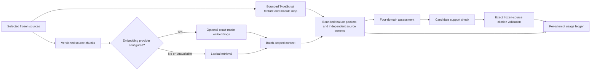

# Static Review token usage assessment and bounded optimization — 25 October 2026

**Status:** Token and file accounting, packet deduplication, prompt-map projection, exact embedding reuse and the model picker are implemented and independently reviewed. GPT-6.1 Sol is saved for Review and a bounded live one-file Review completed with 30,745 recorded tokens, two calls and one unique file. The five-repository offline comparison reduces initial prompt characters by 12.9% with all selected bytes preserved. Actual full-repository savings and semantic quality remain unverified. See [live evidence](../acceptance/TOKEN_OPTIMIZATION_2026-10-25/LIVE_VERIFICATION.md) and [independent review](../acceptance/TOKEN_OPTIMIZATION_2026-10-25/INDEPENDENT_REVIEW.md).

## Scope and evidence

I inspected the current v10 sidecar source, the isolated semantic-support stage notes, and the saved all-scope provider ledger at [`TOKEN_USAGE_BY_STAGE_2026-10-25.md`](../acceptance/PUBLIC_REPO_ACCEPTANCE_V9_RESUME_2026-10-24/TOKEN_USAGE_BY_STAGE_2026-10-25.md) and its JSON companion. I also read the saved five-repository offline prompt-budget fixture. The provider-token totals are recorded usage. Character-to-token conversions below are estimates only.

The historical runs below used provider `codex`, model `gpt-5.6-sol`; their evidence remains unchanged. The new one-file measurement uses `gpt-6.1-sol` and policy `review-2026-10-25-semantic-support-token-context-v11`. The provider adapter resolves the signed-in owner's saved model at request time ([`modelProvider.ts`](../../sidecar/src/review/modelProvider.ts#L127), [`modelProviderResolver.ts`](../../sidecar/src/review/modelProviderResolver.ts)).

### Recorded v9 provider usage

| Execution | Hash-checked unique files (JS/TS) | Packet file inclusions | Calls (usage-unreported) | Input tokens | Output tokens | Total tokens |
| --- | ---: | ---: | ---: | ---: | ---: | ---: |
| Axios | 52 (48) | 142 across 20 packets | 20 (0) | 873,802 | 99,619 | 973,421 |
| Docusaurus | 29 (23) | 218 across 25 packets | 28 (0) | 1,216,774 | 148,234 | 1,365,008 |
| Immutable.js, earlier paused attempt | 80 (75) | 41 across 5 packets | 5 (1) | 160,503 | 20,463 | 180,966 |
| Immutable.js, current paused retry | 80 (75) | 456 across 56 packets | 57 (1) | 2,243,365 | 276,302 | 2,519,667 |
| **Total** | — | — | **110 (2)** | **4,494,444** | **544,618** | **5,039,062** |

The report reconciles the above token totals and attempt counts to saved all-scope usage records. The two usage-unreported calls remain unknown; they are not treated as zero-cost. All recorded model tokens in this dataset are under `model_analysis`. The saved stage report contains no separate embedding/indexing usage for these runs. Physical source reads were one hash-checked read per unique file per Review, reused from the frozen read pool. Packet inclusions repeat those bytes in later requests; they are not additional physical reads.

Docusaurus used 25 initial attempts and 3 domain-coverage repairs. Those repairs add 154,865 recorded tokens, about 11.3% of that execution's total. Immutable.js's current retry used 56 initial attempts and one repair, adding 48,172 tokens, about 1.9% of its total. The 155,796 Docusaurus and 47,878 Immutable.js validation-rejected token figures are already included in their totals.

### Bounded offline five-repository prompt estimates

The existing fixture [`offline-prompt-budget-preflight.json`](../../evidence/public-repo-outcomes-2026-10-22/run-2026-10-24T15-46-37-089Z/offline-prompt-budget-preflight.json) was captured on 24 October against the v9 prompt. It builds requests from the five pinned repository inputs using the local TypeScript parser and deterministic rules; it does not call a provider or execute repository code. Its stress case supplies up to eight 2,400-character ranked chunks and synthetic repair indexes. `Estimated tokens = ceil(characters / 4)` is a rough text estimate, not provider tokenization. The schema payload and provider framing are not included in these character figures.

| Repository | Offline packets / features | System chars / token estimate | Largest user prompt chars / token estimate | Largest citation-repair chars / token estimate | Largest domain-repair chars / token estimate |
| --- | ---: | ---: | ---: | ---: | ---: |
| Axios | 20 / 147 | 6,243 / 1,561 | 122,258 / 30,565 | 127,259 / 31,815 | 135,343 / 33,836 |
| Docusaurus | 25 / 192 | 6,243 / 1,561 | 134,619 / 33,655 | 142,643 / 35,661 | 152,856 / 38,214 |
| Immutable.js | 65 / 510 | 6,243 / 1,561 | 124,461 / 31,116 | 130,380 / 32,595 | 138,962 / 34,741 |
| Three.js | 11 / 80 | 6,243 / 1,561 | 110,118 / 27,530 | 114,733 / 28,684 | 124,063 / 31,016 |
| Preact | 10 / 62 | 6,243 / 1,561 | 136,004 / 34,001 | 142,045 / 35,512 | 151,833 / 37,959 |

These are maximum per-request character counts from the offline fixture, not whole-review totals and not model usage. The v9 saved provider ledger has no usage records for the Three.js or Preact executions. The Immutable.js counts describe different run boundaries: the offline v9 fixture planned the full 65 units, while the live retry built 56 packets before the provider-capacity pause (55 completed); one repair raised provider attempts to 57. These counts are not a planner discrepancy.

The stress fixture's eight excerpts can contribute up to 19,200 duplicate source characters in one request (about 4,800 estimated tokens). This is a per-request upper bound when all eight chunks are full. Across the 110 saved provider attempts it would be at most 528,000 estimated input tokens if every attempt carried all eight full chunks; actual excerpt lengths and presence were not captured, so this is not a claimed saving.

### Current v10 packet comparison

I ran the same five pinned source selections against the current v10 batch plan twice: first with the pre-optimization excerpt bodies and complete per-batch coverage lists, then with exact duplicate excerpt text removed and the prompt-only coverage projection applied. The local TypeScript parser and deterministic checks were used; no repository code or model provider was executed. v10 adds independent source sweeps, so its batch counts below are not comparable to the v9 counts above. Both comparison sides use the same v10 plan and exact same source inputs.

| Repository | v10 packets / features | Selected files / segments | User prompt characters, total (max): before → after | Estimated prompt tokens saved (`ceil(chars/4)`) |
| --- | ---: | ---: | ---: | ---: |
| Axios | 22 / 147 | 52 / 53 | 2,219,315 (122,258) → 1,935,784 (111,017) | 70,883 |
| Docusaurus | 27 / 192 | 29 / 29 | 2,685,289 (134,619) → 2,291,090 (119,321) | 98,550 |
| Immutable.js | 68 / 510 | 80 / 82 | 6,611,890 (124,461) → 5,842,100 (111,345) | 192,448 |
| Three.js | 12 / 80 | 10 / 10 | 943,176 (110,118) → 780,464 (94,858) | 40,678 |
| Preact | 11 / 62 | 21 / 22 | 1,158,350 (136,004) → 1,007,350 (121,039) | 37,750 |
| **All five** | **140 / 991** | **192 / 196** | **13,618,020 → 11,856,788** | **440,308** |

The before/after prompt reduction is 1,761,232 characters across initial packet prompts. The `ceil(chars/4)` figure is an estimate, not measured provider tokens. In a deliberately synthetic stress pass with one citation repair and one domain repair per packet, repair prompts together fall from 29,909,464 to 26,387,000 characters (3,522,464 characters, or about 880,616 estimated tokens). That repair total does not predict live repair frequency. System prompt and output schema characters are unchanged; provider framing and actual output tokens are outside this static benchmark. The full machine-readable report is [`five-repository-prompt-comparison.json`](../acceptance/TOKEN_OPTIMIZATION_2026-10-25/five-repository-prompt-comparison.json), produced by [`prompt-packet-benchmark.mts`](../acceptance/TOKEN_OPTIMIZATION_2026-10-25/prompt-packet-benchmark.mts).

All 192 selected files and 196 unique planned source segments passed exact UTF-8 byte reconstruction across original line ranges. Every feature ID remained present exactly once, and the prompt map's feature/path records were unchanged. The reduction only removed exact same-version excerpt bodies already present in numbered source and unrelated artifact-detail entries from batch coverage lists; it did not remove source segments, guards, domain rows, sweeps or citations.

## Measured causes and v10 cost changes

| Cause | Evidence and current source location | Assessment |
| --- | --- | --- |
| The same selected code appears in multiple feature packets. | v9 usage reports 142 inclusions for 52 unique files, 218 for 29, and 456 for 80. `planAssessmentBatches` deduplicates sources inside one batch, but starts a new batch after eight features or 64,000 source characters, so shared files can recur across batches ([`assessmentBatches.ts:8-10,81-92`](../../sidecar/src/review/assessmentBatches.ts#L8)). | Measured repeated-packet exposure; the ledger does not retain per-file token weights, so file counts cannot be converted to exact token savings. |
| Ranked context excerpts duplicate bytes already present in the full frozen source packet. | `contextForAssessmentBatch` accepts only exact same-version substrings, then retains path/version/chunk ordinal while replacing the second copy with a short source reference ([`assessmentBatches.ts:18-29`](../../sidecar/src/review/assessmentBatches.ts#L18)). The prompt still includes the complete numbered source ([`orchestrator.ts:1769-1796`](../../sidecar/src/review/orchestrator.ts#L1769)). The offline stress fixture supplies up to eight 2,400-character excerpts. | Implemented and measured: across the same five v10 packet plans, initial user prompt text fell by 1,761,232 characters (about 440,308 estimated input tokens at `ceil(chars/4)`). This is not provider usage. |
| Whole-review metadata is repeated in every batch request. | The prompt builder serializes deterministic findings, requirements, standards, reviewer dispositions, frozen relationships and the batch map ([`orchestrator.ts:1759-1796`](../../sidecar/src/review/orchestrator.ts#L1759)). The batch map's artifact-level declaration/non-executable/unsupported lists are now filtered by exact batch artifact ID, with complete counts/flags/limitations retained; the complete map remains the validation/audit value ([`assessmentBatches.ts:35-47`](../../sidecar/src/review/assessmentBatches.ts#L35), [`orchestrator.ts:849-853`](../../sidecar/src/review/orchestrator.ts#L849)). | The benchmark includes measured map-list reductions. Requirements, standards, dispositions, relationships and deterministic findings remain repeated; safe identity-level filtering for those lists is still open and must preserve absence/authority semantics. |
| Non-code documents are broadcast into many feature prompts and still swept separately. | v10 creates a document sweep before adding documents back into each feature batch ([`assessmentBatches.ts:101-115`](../../sidecar/src/review/assessmentBatches.ts#L101)). Each document is appended when it fits the 64,000-character ceiling. | Source-confirmed repeat. Do not remove document relevance blindly: keep the full document sweep, and include bounded, version-checked exact document segments in a feature packet when needed for a contract comparison. |
| Four-domain responses have unconstrained text fields. | Each feature needs four domain rows; the response validator requires four rows per feature ([`assessmentValidation.ts:35-44,394-429`](../../sidecar/src/review/assessmentValidation.ts#L35)). The schema does not bound domain-summary length or evidence-array size. The recorded first-pass outputs average about 4,800–5,300 tokens per reported attempt. | Output is a material share: about 10.2% of Axios, 10.9% of Docusaurus, and 11.0% of the current Immutable retry total. Keep all four rows and exact references; bound only redundant prose and excessive references. |
| Validation repairs resend the base prompt. | Citation repair appends trusted windows to `basePrompt`; domain repair appends the full base plus trusted hints ([`sourcePrompt.ts:67-86,167-214`](../../sidecar/src/review/sourcePrompt.ts#L67)). Docusaurus had three incomplete technical rows and three repair calls; Immutable.js had one. | The observed 154,865 and 48,172 repair tokens are real additional work, already counted above. Prefer compact response constraints and useful validation guidance before a repair; keep the five-attempt safety contract. |
| v10 adds mandatory semantic source sweeps and candidate support calls. | v10 adds independent sweeps for every selected source-code segment, plus a document sweep ([`assessmentBatches.ts:93-108`](../../sidecar/src/review/assessmentBatches.ts#L93)). Candidate support resends the complete batch source and collected authorities ([`sourcePrompt.ts:21-64`](../../sidecar/src/review/sourcePrompt.ts#L21), [`orchestrator.ts:22-55,1079-1082`](../../sidecar/src/review/orchestrator.ts#L22)). Three attempts are allocated to generation/repair/fallback and two to support/repair within five per stable batch operation ([`orchestrator.ts:18-20,1171-1190`](../../sidecar/src/review/orchestrator.ts#L18)). | Intended v10 coverage cost; there is no v10 provider-token ledger yet. Keep the independent sweeps and support gate, then reduce repeated bytes and irrelevant authority context without weakening proof. |
| Embedding indexing can regenerate vectors for unchanged chunks. | The configured embedding provider is resolved from the signed-in user's settings ([`modelSettings.ts:233-247`](../../sidecar/src/modelSettings.ts#L233)). Indexing now reads only metadata for non-null vectors under the already member-checked project client and reuses a vector only for the same user, project/version, artifact/path/source hash, chunk hash, configured endpoint/model, 1536 dimensions and chunk policy ([`knowledgeIndex.ts:37-84,126-165`](../../sidecar/src/review/knowledgeIndex.ts#L37)). | Implemented with lexical fallback intact. An exact cache hit makes no provider call and writes no synthetic usage record. No embedding calls were in the saved v9 ledger, so live savings remain unmeasured. |
| Dynamic output schemas may vary across requests. | Assessment schema enums contain the current batch's feature IDs ([`assessmentValidation.ts:63-70`](../../sidecar/src/review/assessmentValidation.ts#L63)); support schema contains the current candidate IDs ([`orchestrator.ts:1092-1102`](../../sidecar/src/review/orchestrator.ts#L1092)). v10's context guard counts serialized schema chars, but `build_request` harness output currently reports only prompt and system prompt lengths. | Measure schema character counts separately. Prefix caching is not established by local source. The current Codex app-server call has no explicit prompt-cache setting in this path; do not book savings until a provider reports cache-read/cache-creation usage. |

## Review request flow

## Implemented changes and remaining work

1. **Stage usage and file references.** Accounting preserves raw provider totals, provenance-tagged adapter arithmetic and unknown values separately from estimates. Metadata carries safe phase, versioned source references and component character counts. Its runtime estimate is `ceil((prompt + system + schema characters)/2)`; it is a heuristic, not provider usage. This is distinct from the offline benchmark's rough `ceil(prompt characters/4)` estimate. Source-indexing attempts point to the frozen artifact with null line ranges because chunks are character-sliced; query-embedding records use `sources: []` because their input is the retrieval query. Known usage survives cancellation and malformed responses. The UI and live one-file Review verify stage/phase/file reconciliation without logging request bodies or rejected responses.

2. **Duplicate prompt context.** Exact same-version retrieved text already present in the full numbered source is replaced with a short reference while preserving path, version and chunk ordinal. The prompt-only batch map keeps every current feature/path and global coverage count, flag and limitation, but filters unrelated artifact-detail entries. The full canonical map remains the validation and audit map. The five-repository static benchmark reports 1,761,232 fewer initial prompt characters with exact selected-source byte coverage intact.

3. **Embedding cache.** Indexing reuses a stored vector only when the member-scoped project/version lookup, content hash, owner, source identity, configured endpoint/model key, dimensions and chunk policy all match. A cache hit produces no provider attempt or synthetic usage record. Unconfigured embedding preserves existing vectors and leaves retrieval lexical; missing or incompatible vectors are never fabricated. The configured provider and its 1536-dimension contract remain unchanged.

4. **Deliberately not reduced yet.** Non-code sources keep their full independent sweep and current feature-packet inclusion behavior. Requirements, standards, reviewer dispositions, relationships and deterministic findings remain whole-review prompt context until exact batch filtering can preserve authority and absence semantics. Four-domain rows and evidence remain complete; domain-summary/evidence-array size is still not schema-bounded. Codex/app-server prompt caching is not assumed or measured.

5. **Configured model measurement.** Historical runs above retain `gpt-5.6-sol`. The user's saved Review model is now `gpt-6.1-sol`, verified on both successful live one-file attempts. Model choices use the real account/native CLI catalog; the native fallback is explicitly labeled when the public catalog rejects the existing OAuth session. No model is hardcoded as the production default. Full-repository comparison on the new configuration remains outstanding.

## Acceptance checks

| Feature | Acceptance criteria | Status | Risk flags |
| --- | --- | --- | --- |
| Per-stage accounting | Provider-reported tokens remain distinct from null/estimated values; safe phase/source/component metadata reconciles to attempts and contains no request body. | Passed: local regressions, independent review and live 30,745-token/two-call reconciliation. | Runtime `/2` and offline `/4` estimates are separate heuristics; neither is billed usage. Historical missing values remain unknown. |
| Five-repository prompt reduction | Same pinned five inputs and same v10 plan compared before/after; prompt/system/schema and synthetic repair chars counted separately. | Passed: 1,761,232 initial prompt chars saved; system/schema unchanged. | `/4` estimate is not provider tokenization; repair frequency is synthetic. |
| Source and map proof | All selected bytes and feature IDs remain present; complete map stays available to validation/audit. | Passed: 192 selected files, 196 unique segments, five cases with exact byte reconstruction and exact feature-ID coverage. | This proves packet inclusion, not whole-program semantic correctness. |
| Document coverage | Selected documents remain fully swept and source bytes are preserved. | Preserved; no relevance pruning shipped. | A future contract-context reducer needs explicit false-omission tests. |
| Embedding reuse | Exact owner/model/source/chunk matches reuse real 1536-dimensional vectors; mismatches re-embed; lexical path remains honest. | Focused offline mock tests cover cache hit, owner/config misses, no-provider behavior and usage metadata. | No production provider/DB test was run; saved v9 ledger had no embedding usage to compare. |
| v10 call/capacity budget | Keep the five-attempt stable-batch ceiling, capacity stop and explicit partial state. | Existing v10 behavior retained; 32 targeted packet/index tests passed. | Sweeps and candidate support are intentional extra v10 work; live usage is not yet measured. |
| Configured target model | Verify actual saved attempts report `gpt-6.1-sol`. | Passed: saved through Settings, both live Review attempts report the exact model. | Public catalog unavailable for this OAuth session; native CLI catalog fallback is disclosed. |

The local implementation is accepted with the scoped checks above. The static benchmark demonstrates application packet reduction; the one-file run demonstrates real accounting and model access. Neither establishes a percentage reduction in billed tokens for a full repository or acceptance of the separate five-repository quality benchmark.

## Codex app-server request framing: measured floor and supported controls

The configured Codex request has a large measured input total even when the application text is tiny. The `gpt-6.1-sol` Settings text test used 12,306 input and 15 output tokens. Its visible test content is 71 system-prompt characters, 26 user-prompt characters and a 110-character output schema (207 tracked characters); the adapter also sends a fixed 164-character `baseInstructions` string ([`codexTest.ts`](../../sidecar/src/model/codexTest.ts), [`codex.ts`](../../sidecar/src/model/codex.ts#L269)). The runtime `/2` component estimate is about 104 tokens for the tracked 207 characters, or about 186 if the visible base instruction is added. Those are rough heuristics, not tokenization. The offline benchmark's `/4` estimate is a separate heuristic. The approximately 12.1K-token difference is **unattributed**: it demonstrates that application characters alone do not explain the provider-reported total, but does not prove a fixed 12.1K Codex overhead or identify any specific hidden instruction/tool.

For the live one-file Review, the two requests reported 30,031 input tokens while the captured application system, schema and user components totaled 28,252 characters. The units differ, so this is not a direct subtraction or a Codex-overhead measurement. Cache reads were zero, and cache-write counts were unavailable in that run; see [`LIVE_VERIFICATION.md`](../acceptance/TOKEN_OPTIMIZATION_2026-10-25/LIVE_VERIFICATION.md).

The current integration already removes several optional capabilities before app-server starts: `CODEX_ARGS` disables `shell_tool`, `unified_exec`, web search and image viewing ([`codex.ts:29`](../../sidecar/src/model/codex.ts#L29)). Each generation creates a fresh ephemeral, read-only thread; it passes explicit base and developer instructions, then a turn input and output schema. It omits `dynamicTools`; the adapter rejects server tool requests. This establishes Centinel's intended tool boundary, but does not reveal which internal Codex instructions or tool definitions the model request renderer counts.

An offline schema bundle generated with the device-local Codex CLI `0.164.0` confirms that `ThreadStartParams` accepts `baseInstructions`, `developerInstructions`, `dynamicTools`, `config`, `personality`, `sandbox`, and `ephemeral`; `TurnStartParams` accepts `input`, `outputSchema`, and `effort`. It has no `prompt_cache_options`, `prompt_cache_key`, input-token budget or generic per-turn tool-allowlist field. `dynamicTools` is the optional list of additional caller-defined tools, not a tool-removal list. The installed CLI's `app-server --help` exposes repeatable `--disable <FEATURE>` controls. This schema/help inspection started no inference request and changed no authentication.

### What may lower the app-server floor

| Control | Evidence | Recommendation and limit |
| --- | --- | --- |
| Disable unused optional Codex features | Official [Codex configuration docs](https://developers.openai.com/codex/config-basic) list `apps`, `goals`, `hooks`, `multi_agent`, `remote_plugin`, and `shell_snapshot` as feature toggles, several enabled by default. The current process disables shell execution and web/image capabilities, but not all of those flags. | A narrowly scoped A/B can explicitly disable only features Centinel does not use, while preserving the existing read-only sandbox and execution restrictions. Whether any remaining feature contributes model-visible tokens is unknown; compare provider-reported input/cache metrics on an authorized minimal test before claiming savings. This audit made no model calls. |
| Omit built-in personality text | Official config docs say `personality = "none"` removes the built-in `Personality` section and does not change explicit custom base instructions. The current request supplies its own `baseInstructions`; the local 0.164 thread schema also accepts personality/config values. | A low-risk candidate for the app-server process configuration, but its byte/token effect is unmeasured and may be small or zero. Do not remove Centinel's explicit safety instructions. |
| Lower reasoning effort | `turn/start` supports `effort`; official [reasoning guidance](https://developers.openai.com/api/docs/guides/reasoning) describes effort as a reasoning control. | Evaluate only for latency/output/reasoning cost and semantic quality. The Settings test already emits 15 output tokens, and effort is not evidence for reducing input framing. |
| Prompt caching or thread reuse | Official [prompt-caching docs](https://developers.openai.com/api/docs/guides/prompt-caching) describe Responses API caching, but [Sign in with ChatGPT preview limitations](https://developers.openai.com/siwc/token-sharing-open-source/preview-limitations) state that app-server uses its RPC inputs and does not accept arbitrary Responses API parameters. The local 0.164 RPC schema has no explicit cache controls; app-server reports cached-input counters, and the live requests reported zero cache reads. | Keep stable prefixes and observe provider-reported cache reads/writes where available. Do not promise savings from prompt order, a cache key, or cache lifetime setting that this integration cannot pass. Do not replace fresh per-call ephemeral threads with cross-review history to seek cache reuse: that would alter privacy/isolation semantics. |

The immediate measured savings therefore remain the deterministic packet reduction in the previous section. Additional tool-feature/personality reductions are hypotheses until a controlled native-app-server test demonstrates fewer provider-reported input tokens and keeps the same output/validation behavior. No settings-test or Review model call was made for this audit, and no code, model selection, authentication, or user configuration was changed.
